# Sistema de arquivos baseado em i-nodes

Implementação em Python de um sistema de arquivos com disco virtual de 128 MiB, blocos de 2.048 bytes e armazenamento persistente.

O sistema permite criar, ler, copiar, mover e remover arquivos e diretórios, além de trabalhar com links simbólicos e caminhos absolutos e relativos.

O sistema é multiusuário: cada usuário entra com login e senha, possui uma área própria (`/home/usuario`) e todos os arquivos e diretórios têm um dono e permissões de leitura e escrita para o dono e para os demais usuários. As senhas são guardadas apenas como hash, em um arquivo inacessível aos usuários comuns. Os detalhes estão na seção [Usuários, senhas e permissões](#usuários-senhas-e-permissões).

## Demonstração do terminal



A animação mostra uma sessão demonstrativa executada com `main.py`: `mkdir`, `cd`, `echo`, `cat`, `cp`, `mv`, `ln -s`, `ls -l` e `rm`. Os dados são fictícios; não são exibidas senhas. **Dica:** para testar, execute `python main.py` conforme as instruções abaixo.

## Requisitos

- Python 3.10 ou superior.
- Não é necessário instalar bibliotecas adicionais.

## Execução

Extraia o arquivo compactado e abra o terminal na pasta `sistema_de_arquivos`.

Execute:

```bash
python main.py
```

No Windows, também pode ser utilizado:

```bash
py main.py
```

No Linux:

```bash
python3 main.py
```

Na primeira execução, o programa pede a senha do administrador (`root`). Em seguida, e em todas as execuções seguintes, pede o login:

```text
Primeira execução: defina a senha do usuário root.
Nova senha do root:
login: root
senha:
Bem-vindo(a), root.
root@myfs>
```

No terminal, a senha não aparece enquanto é digitada. O prompt mostra o usuário conectado.

Digite os comandos nesse terminal. Para encerrar, utilize:

```text
exit
```

O programa também encerra ao receber `Ctrl+C` ou o fim da entrada.

Na primeira execução, é criado o arquivo `filesystem.img`, que representa o disco virtual. Execute o programa na mesma pasta para continuar utilizando os dados armazenados.

Os caminhos informados nos comandos pertencem ao disco virtual, não às pastas do computador.

## Arquivos do projeto

| Arquivo | Descrição |
|---|---|
| `main.py` | Implementação do sistema e terminal de comandos |
| `README.md` | Instruções de execução e funcionamento |
| `testes.py` | Testes automatizados |
| `VALIDACAO.md` | Descrição dos testes e resultados |
| `roteiro_demonstracao.txt` | Sequência de comandos para demonstração |

## Organização do disco

| Estrutura | Configuração |
|---|---|
| Capacidade total | 134.217.728 bytes — 128 MiB |
| Tamanho dos blocos | 2.048 bytes |
| Quantidade de blocos | 65.536 |
| Área de gerenciamento | 2.048 blocos — 4 MiB |
| Área de dados | 63.488 blocos — 124 MiB |
| Quantidade máxima de i-nodes | 8.192 |
| Apontadores diretos por i-node | 12 |

Os primeiros 4 MiB armazenam os i-nodes e os mapas de ocupação. Os 124 MiB restantes são compartilhados por arquivos, diretórios e links.

Os mapas `bitmap_inode` e `bitmap_bloco` são listas nas quais:

- `0` indica uma posição livre;
- `1` indica uma posição ocupada.

O deslocamento de um bloco na imagem é calculado por:

```python
numero_do_bloco * TAM_BLOCO
```

Os metadados são serializados com `pickle`. Os primeiros oito bytes da imagem indicam o tamanho dessa serialização. Antes da gravação, o programa verifica se os metadados cabem na área reservada.

## Estrutura dos i-nodes

Cada i-node contém:

- Nome e tipo da entrada.
- Criador e dono.
- Tamanho do conteúdo em bytes.
- Datas de criação e modificação.
- Permissões de acesso.
- Doze apontadores para blocos.
- Apontador `proximo`, utilizado no encadeamento.

Os doze apontadores armazenam até 24 KiB de conteúdo. Quando esse espaço é insuficiente, outro i-node é reservado e ligado ao anterior pelo campo `proximo`.

O tamanho total do conteúdo fica no i-node principal. Apontadores não utilizados recebem o valor `-1`.

Criador e dono recebem o usuário que criou a entrada. O campo `permissoes` tem quatro caracteres, explicados na próxima seção.

## Usuários, senhas e permissões

### Usuários e áreas de armazenamento

Na primeira execução são criados:

| Caminho | Dono | Permissões | Uso |
|---|---|---|---|
| `/etc` | root | `rwr-` | Arquivos do sistema |
| `/etc/shadow` | root | `rw--` | Contas e hashes das senhas |
| `/home` | root | `rwr-` | Contém as homes dos usuários |
| `/root` | root | `rw--` | Home do root |

O `root` cria usuários com `useradd`. Cada novo usuário recebe `/home/nome`, com dono igual ao próprio usuário e permissões `rw--`: só ele (e o root) acessa. Após o login, o diretório atual passa a ser a home do usuário.

### Permissões

Cada entrada tem dois conjuntos de permissões, de leitura (`r`) e escrita (`w`): o primeiro para o dono e o segundo para os demais usuários. Um `-` indica permissão ausente.

```text
rwr-   dono lê e escreve; demais usuários só leem (padrão de novas entradas)
rw--   só o dono lê e escreve
rwrw   todos leem e escrevem
r---   só o dono lê; ninguém escreve
```

As regras seguem o Unix, adaptadas a um sistema sem o bit `x`:

| Operação | Permissão exigida |
|---|---|
| Ler um arquivo (`cat`, origem do `cp`) | `r` no arquivo |
| Alterar um arquivo (`echo`, destino do `cp`, `touch` de arquivo existente) | `w` no arquivo |
| Listar ou entrar em um diretório (`ls`, `cd`) | `r` no diretório |
| Atravessar um diretório em um caminho (`/a/b/c` exige `r` em `/`, `a` e `b`) | `r` em cada diretório |
| Criar ou remover entradas (`touch`, `echo` e `cp` criando, `mkdir`, `rm`, `rmdir`, `ln`) | `w` no diretório pai |
| Mover ou renomear (`mv`) | `w` nos dois diretórios pais; ao trocar um diretório de pai, também `w` nele |
| `chmod` | ser o dono ou o root |
| `chown`, `useradd`, `passwd` de outro usuário | ser o root |

O `root` não é limitado pelas permissões, como no Unix. Um link simbólico não tem permissões próprias que importem: valem as do alvo.

Quando uma permissão falta, o comando é recusado com `Erro: Permissão negada` e nada é alterado na imagem.

### Senhas

As contas ficam em `/etc/shadow`, no próprio disco virtual, uma por linha:

```text
usuario:sal:hash
```

- A senha nunca é gravada em texto plano. É armazenado o hash PBKDF2-HMAC-SHA256 com 100.000 repetições, que torna lenta cada tentativa de adivinhar a senha.
- Cada senha tem um sal aleatório de 16 bytes, então dois usuários com a mesma senha têm hashes diferentes.
- A comparação usa `hmac.compare_digest`, cujo tempo não revela em que ponto a senha difere.
- O arquivo pertence ao root com permissões `rw--`, e `/etc` só pode ser alterado pelo root. Um usuário comum não consegue ler, copiar, alterar, renomear nem remover `/etc/shadow`, nem por meio de um link simbólico.
- Login errado mostra a mesma mensagem para usuário inexistente e senha incorreta.

### Comandos de segurança

| Comando | Operação |
|---|---|
| `useradd nome` | (root) Cria o usuário e sua home; pede a senha |
| `passwd` | Troca a própria senha; usuários comuns precisam informar a senha atual |
| `passwd nome` | (root) Troca a senha de outro usuário |
| `chmod permissoes caminho` | (dono ou root) Altera as permissões |
| `chown usuario caminho` | (root) Altera o dono |
| `whoami` | Mostra o usuário conectado |
| `logout` | Encerra a sessão e volta ao login |
| `ls -l [caminho]` | Lista com tipo, permissões, dono e tamanho |

No `chmod`, as permissões podem ser escritas com quatro caracteres (`rwr-`) ou com dois dígitos, um para o dono e outro para os demais, somando `r = 4` e `w = 2`:

```text
chmod rw-- diario.txt     (equivale a chmod 60 diario.txt)
chmod 64 publico.txt      (equivale a chmod rwr- publico.txt)
```

Somente o root usa `chown`, como no Unix: se qualquer dono pudesse transferir arquivos, um usuário poderia atribuir a outro arquivos que não são dele.

Nomes de usuário usam letras minúsculas, números, `_` e `-` e começam com letra ou `_`.

Exemplo de `ls -l /home`:

```text
drwr-  root             47  .
drwr-  root             55  ..
drwr-  alice            60  alice
drw--  bob              29  bob
```

O primeiro caractere indica o tipo: `d` diretório, `-` arquivo, `l` link.

## Comandos de arquivos

| Comando | Operação |
|---|---|
| `touch arquivo` | Cria um arquivo vazio ou atualiza a data de modificação de uma entrada existente |
| `rm arquivo` | Remove um arquivo ou link |
| `echo "texto" > arquivo` | Cria um arquivo ou substitui seu conteúdo |
| `echo "texto" >> arquivo` | Acrescenta conteúdo ou cria o arquivo se necessário |
| `cat arquivo` | Exibe o conteúdo |
| `cp origem destino` | Copia o conteúdo de um arquivo |
| `mv origem destino` | Move ou renomeia uma entrada |
| `ln -s alvo link` | Cria um link simbólico |

No comando `echo`, use aspas quando o texto contiver espaços. Os operadores `>` e `>>` podem ser utilizados com ou sem espaços ao redor.

O `echo` não acrescenta uma quebra de linha ao conteúdo armazenado. O `cat` acrescenta uma quebra de linha apenas na exibição.

O `cp` pode substituir o conteúdo de um arquivo existente, mas recusa origem e destino que correspondam ao mesmo i-node.

O `mv` recusa destinos já ocupados. Quando o destino é um diretório, a entrada é movida para dentro dele, mantendo seu nome.

## Comandos de diretórios

| Comando | Operação |
|---|---|
| `mkdir diretorio` | Cria um diretório |
| `rmdir diretorio` | Remove um diretório vazio |
| `ls diretorio` | Lista as entradas |
| `cd diretorio` | Altera o diretório atual |
| `mv origem destino` | Move ou renomeia um diretório |
| `ln -s alvo link` | Cria um link simbólico para um diretório |

Sem argumento, `ls` lista o diretório atual.

Cada diretório armazena uma associação entre nomes e números de i-node. Também contém:

- `.`: referência ao próprio diretório.
- `..`: referência ao diretório pai.

Na raiz, ambas apontam para o i-node 0.

O sistema impede remover a raiz, remover o diretório atual e alterar diretamente as entradas `.` e `..`. Também impede mover um diretório para dentro dele mesmo ou de seus descendentes.

## Caminhos e links

Os comandos aceitam caminhos absolutos e relativos:

```text
/documentos/arquivo.txt
arquivo.txt
./arquivo.txt
../arquivo.txt
```

Caminhos absolutos começam na raiz. Caminhos relativos começam no diretório atual. Os diretórios intermediários precisam existir.

Nomes com espaços devem ser colocados entre aspas:

```text
mkdir "meus documentos"
```

Um link simbólico armazena o caminho do alvo. Quando esse caminho é relativo, ele é interpretado a partir do diretório que contém o link.

Remover um link com `rm` não remove seu alvo. Na origem de `mv`, o link também é tratado como uma entrada própria.

Links podem apontar para arquivos ainda inexistentes. `touch` e `echo` podem criar esse alvo, desde que o diretório pai exista.

A resolução de um caminho permite até 40 expansões de links. Ao ultrapassar esse limite, o comando é recusado.

Por proteção, operações como `rm link/`, `rmdir link/` e `mv link/ destino` são recusadas quando a última entrada é um link. Para remover apenas o link, utilize `rm link`.

## Persistência e tratamento de erros

Os dados são armazenados em `filesystem.img` e recuperados na próxima execução.

Cada comando de alteração utiliza `transacao()`, que:

1. Guarda uma cópia dos i-nodes e mapas em memória.
2. Prepara os blocos modificados sem gravá-los imediatamente.
3. Restaura o estado anterior se ocorrer um erro durante a preparação.
4. Grava os blocos e metadados após a conclusão das verificações.

Antes de substituir conteúdo, `escrever()` verifica se existem blocos e i-nodes suficientes, considerando os recursos que o próprio arquivo pode reutilizar.

Os comandos `cat`, `ls` e `cd` não regravam os metadados. Cada comando de alteração concluído já deixa seus dados persistidos.

Usuários, senhas, donos e permissões também ficam na imagem. Ao iniciar novamente, é necessário fazer login, e o diretório atual é a home do usuário.

Uma imagem da versão anterior (sem usuários) é convertida ao abrir: as permissões `rwxr-x` viram `rwr-`, o dono passa a ser `root` e são criados `/etc/shadow`, `/home` e `/root`.

## Limites da implementação

- Nomes novos podem ter até 255 bytes em UTF-8.
- Muitos arquivos pequenos podem esgotar os i-nodes antes dos blocos.
- Não há cópia recursiva de diretórios.
- Não há grupos de usuários nem remoção de usuários.
- A imagem `filesystem.img` em si fica acessível a quem usa o computador hospedeiro; a proteção vale dentro do sistema de arquivos virtual. Mesmo assim, ela guarda só os hashes das senhas.
- O acréscimo com `echo >>` relê e prepara o conteúdo completo.
- A imagem deve ser utilizada por uma única instância por vez.
- Não há recuperação automática de queda de energia ou interrupção durante a gravação final.
- A imagem utiliza `pickle`; devem ser abertas apenas imagens de procedência conhecida.

## Exemplo de uso

Após o login como root (o diretório inicial é `/root`):

```text
cd /
mkdir documentos
cd documentos
echo "conteudo inicial" > arquivo.txt
echo " e mais conteudo" >> arquivo.txt
cp arquivo.txt copia.txt
mv copia.txt renomeado.txt
ln -s arquivo.txt atalho.txt
cat atalho.txt
rm atalho.txt
cat arquivo.txt
cd ..
ls documentos
exit
```

Ao executar novamente, faça login e consulte o arquivo:

```text
cat /documentos/arquivo.txt
```

Resultado esperado:

```text
conteudo inicial e mais conteudo
```

## Testes automatizados

Na pasta do projeto, execute:

```bash
python -m unittest -v testes
```

A suíte contém 40 testes com subcasos. Os testes utilizam imagens temporárias e não alteram o disco da demonstração.

O teste de capacidade utiliza temporariamente cerca de 128 MiB em disco e algumas centenas de MiB de memória.

## Demonstração automática

O arquivo `roteiro_demonstracao.txt` contém uma sequência de comandos em duas partes:

1. **Arquivos, diretórios e links** (como root): o mesmo roteiro da versão anterior.
2. **Segurança**: o root cria `alice` e `bob`; uma tentativa de login com senha errada; `alice` tenta ler, copiar, alterar e remover `/etc/shadow`, criar diretório em `/home` e usar `chown` (tudo recusado), depois usa `chmod` em seus arquivos e na home; `bob` lê o arquivo público da alice, mas não consegue ler o privado, escrever, usar `chmod` nem remover; o root faz `chown` do arquivo para `bob`, que passa a poder escrevê-lo; por fim `bob` troca a própria senha e só a nova é aceita.

As senhas usadas no roteiro são `senhaRoot`, `senhaAlice` e `senhaBob` (depois `novaSenhaBob`).

Execute o roteiro em uma pasta de demonstração nova, sem uma imagem `filesystem.img` existente, pois ele define a senha do root e utiliza nomes fixos.

No Prompt de Comando do Windows, Linux ou macOS:

```bash
python main.py < roteiro_demonstracao.txt
```

No PowerShell:

```powershell
Get-Content roteiro_demonstracao.txt | python main.py
```

Com a entrada redirecionada, as senhas são lidas como linhas comuns, por isso aparecem no arquivo do roteiro. O roteiro produz 13 linhas `Erro:`, todas esperadas: são as tentativas que devem ser recusadas.

Depois, abra o programa novamente, entre como `bob` (senha `novaSenhaBob`) e execute:

```text
cat /home/alice/publico.txt
cat /home/alice/diario.txt
```

Resultado esperado:

```text
texto publico (agora o arquivo e do bob)
Erro: Permissão negada (leitura): diario.txt
```
